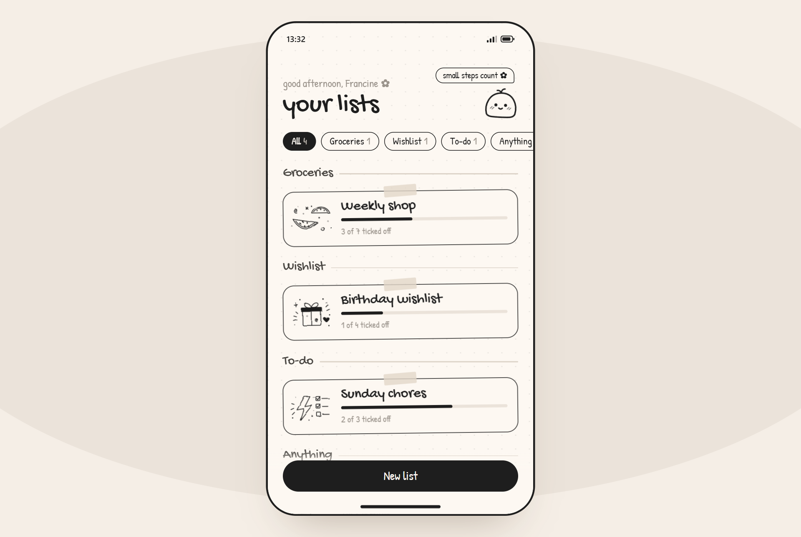
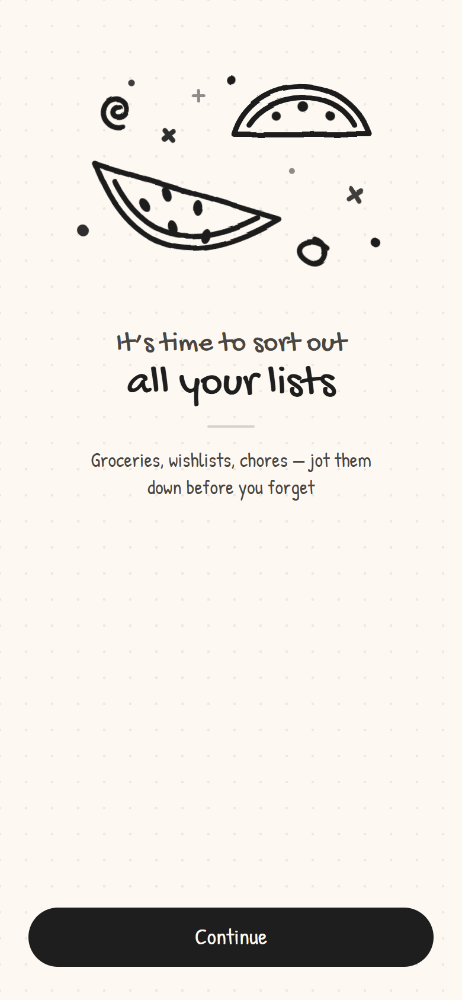
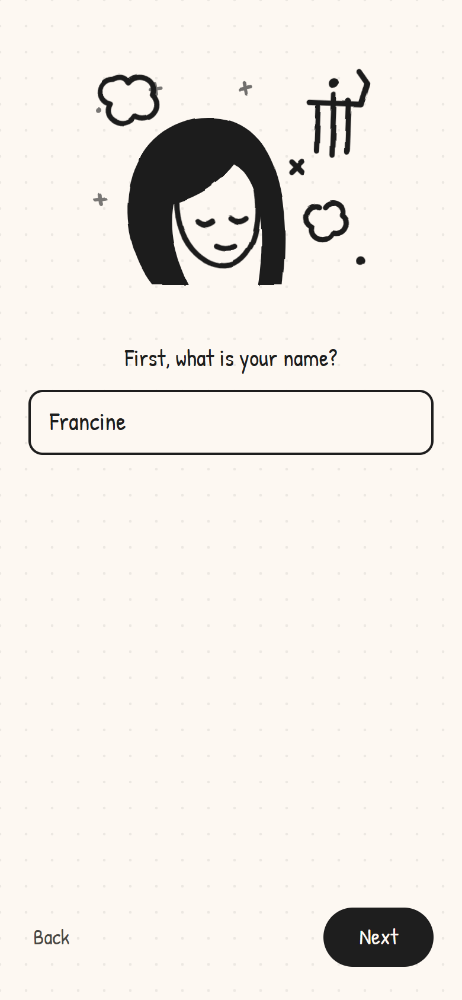
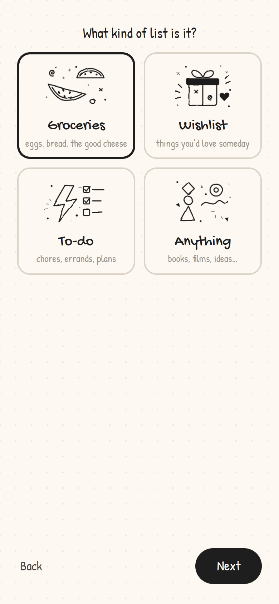
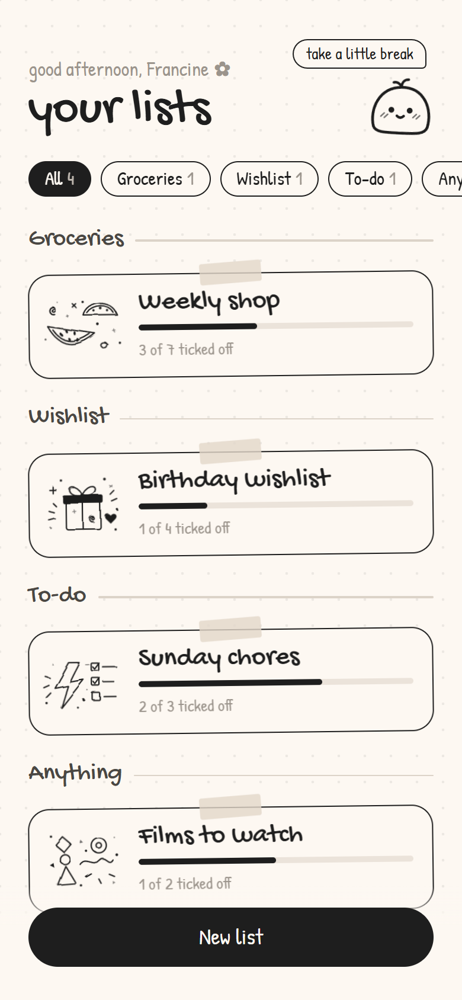
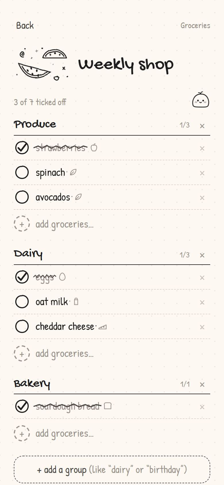
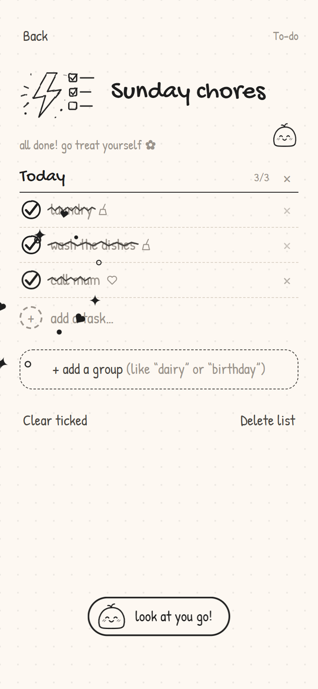

# Scribble Lists ✿

A tiny, doodly list app for groceries, wishlists, to-dos and anything else. It's minimal, cute and hand-drawn, a bit like a notebook page.

**Live:** https://scribble-lists.vercel.app

<p align="center">
  
</p>

## Screenshots

<table>
  <tr>
    <td align="center"><br><sub>Welcome</sub></td>
    <td align="center"><br><sub>What's your name?</sub></td>
    <td align="center"><br><sub>Pick a list type</sub></td>
  </tr>
  <tr>
    <td align="center"><br><sub>Lists, grouped by type</sub></td>
    <td align="center"><br><sub>Groups, scribbles &amp; stickers</sub></td>
    <td align="center"><br><sub>All done celebration</sub></td>
  </tr>
</table>

## Features

- **Lists by type:** Groceries, Wishlist, To-do or Anything. The home screen groups your lists by type, and you can filter them.
- **Groups inside a list:** for example "Dairy" and "Produce" in a grocery list, or "Birthday" and "Someday" in a wishlist. Tap a name to rename it.
- **Setup steps:** your name, the list's name and its type, then "you're ready".
- **Hand-drawn feel:** wobbly ink doodles with gentle idle animations, handwritten fonts (Gochi Hand and Patrick Hand), and cards taped on like paper scraps.
- **A mochi mascot:** it blinks and sways, hops when you add something, and says something nice when you tap it.
- **Satisfying tick-offs:** a crayon scribble crosses each item out, with small sparkles. Finishing a list gets a bigger burst and a note from the mascot.
- **Auto stickers:** small line icons appear on items like eggs, milk, fruit, coffee, books and gifts.
- **Reduced motion:** turns the animations off when your device asks for less motion.

Lists are saved in your browser (localStorage), so each device keeps its own lists.

## Tech

Plain HTML, CSS and JavaScript, with no framework and no build step.

| File | What's in it |
| --- | --- |
| `index.html` | Page shell, fonts and the wobbly-line SVG filter |
| `style.css` | Look, layout and animations |
| `app.js` | Doodles, mascot, screens and saving |

## Run locally

Open `index.html` in a browser, or serve the folder with any static server:

```
npx serve .
```

## Deploy

The repo is connected to Vercel, so every push to `main` deploys to https://scribble-lists.vercel.app. Pushes to other branches get their own preview links.
